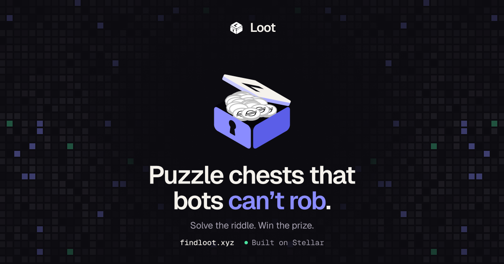
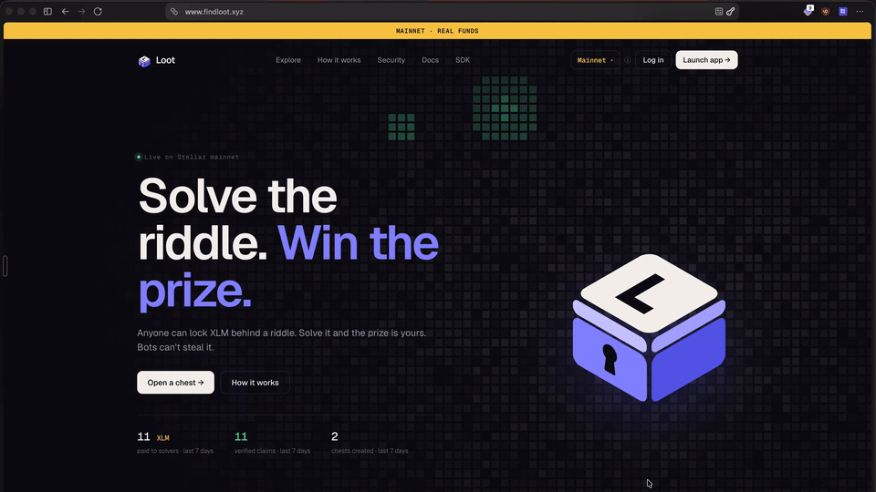
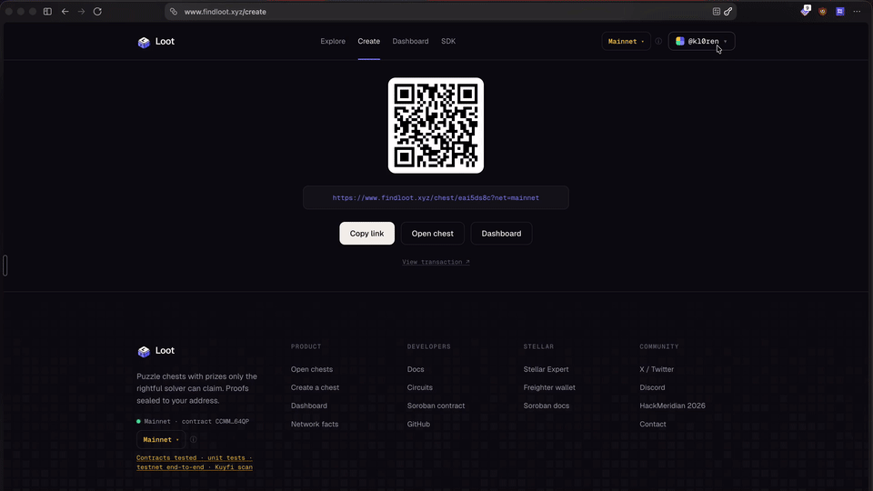
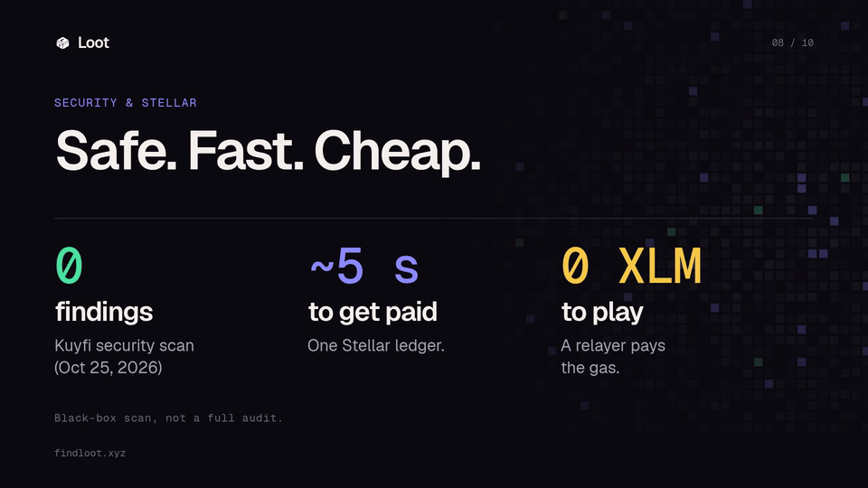
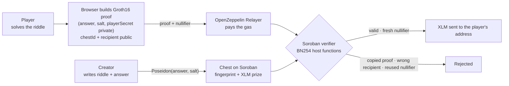

<div align="center">



<h3>Puzzle chests that bots can't rob.</h3>

<p>Creators lock XLM in puzzle chests. Players solve the riddle and claim the prize with a<br/>
zero-knowledge proof bound to their own address, so a bot can't copy the answer.</p>

<p>
  <a href="https://www.findloot.xyz"></a>
  
  
  <a href="https://www.npmjs.com/package/@findloot/sdk"></a>
  <a href="LICENSE"></a>
</p>

<p>
  <a href="https://www.findloot.xyz"><b>Live app</b></a> ·
  <a href="https://www.npmjs.com/package/@findloot/sdk"><b>SDK</b></a> ·
  <a href="#how-it-works"><b>How it works</b></a> ·
  <a href="#why-zero-knowledge-zk"><b>Why ZK</b></a> ·
  <a href="#why-an-sdk"><b>Why an SDK</b></a> ·
  <a href="#use-cases"><b>Use cases</b></a> ·
  <a href="#contracts"><b>Contracts</b></a> ·
  <a href="#local-development"><b>Run locally</b></a>
</p>

</div>

---

## What is Loot

A community posts a riddle with a prize. Someone solves it, and a bot watching the network copies the answer and claims first. **Loot fixes that.**

On Loot, a creator locks XLM in a **puzzle chest** on Stellar. To claim, a player proves they know the answer with a **zero-knowledge proof** that never reveals the answer and is **bound to the player's own address**. If someone copies the proof and swaps in their own address, the on-chain verifier rejects it.

- **Status:** live on Stellar mainnet (with prize caps) and testnet.
- **App:** [findloot.xyz](https://www.findloot.xyz). Switch between Mainnet and Testnet from the network menu.

## See it in action

<table>
  <tr>
    <td align="center" width="50%"><br/><sub><b>1. Create a chest</b></sub></td>
    <td align="center" width="50%"><br/><sub><b>2. Sign up and claim</b></sub></td>
  </tr>
  <tr>
    <td align="center" colspan="2"><br/><sub><b>3. Build with the SDK</b></sub></td>
  </tr>
</table>

## How it works



1. **Lock.** The creator publishes a riddle. Only the fingerprint `Poseidon(answer, salt)` goes on-chain, with the XLM prize.
2. **Solve.** The player types an answer. The browser generates a Groth16 proof that the answer matches the fingerprint.
3. **Bind.** The proof commits to the `recipient` address and a nullifier `Poseidon(playerSecret, chestId)`, so it pays one address, once.
4. **Claim.** The Soroban contract verifies the proof on-chain and releases the prize. The relayer pays the fees, so the player needs no gas.

## Why zero-knowledge (ZK)?

Without ZK, a puzzle prize on a public blockchain has two problems.

**1. The answer leaks.** If the contract stores the answer, or the player sends it in plain text to claim, anyone can read it on-chain or in the mempool. The first person to solve it pays a fee to reveal it, and everyone else gets it for free.

**2. Bots steal the claim (front-running).** Even if the answer is hidden until the claim, the claim transaction itself shows it. A bot watching the network copies it, puts in its own address and pays more to land first. The real solver loses. Our **Attack mode** shows this live: a normal chest loses to a copy bot in seconds.

**What ZK changes:**

| Without ZK | With Loot (ZK) |
|---|---|
| The answer or its hash is visible and can be replayed | Only a fingerprint `Poseidon(answer, salt)` is on-chain, and the answer is never sent |
| A bot can copy the claim and change the address | The proof is **bound to the recipient address**, so a changed address gives `InvalidProof` |
| The same proof can be replayed | A **nullifier** `Poseidon(playerSecret, chestId)` is spent on-chain, so each proof works only once |
| You need a trusted server to check answers | The **Soroban contract verifies the proof on-chain**, with no server or admin deciding |

In simple words, the player proves *"I know the answer"* without showing it, and the proof only pays **their** wallet, **once**. Nobody, including us, has to be trusted to judge who won.

**Why Groth16 on Stellar:** Groth16 proofs are small and cheap to verify. Stellar's BN254 host functions let a Soroban contract verify them on-chain at a low cost, and Stellar's low fees plus a relayer mean players pay nothing.

## Why an SDK?

Loot is not only an app. It is a **building block**. The cryptography is the hard part: the circuit, the trusted setup, answer normalization, Poseidon hashing, the verifier and contract bindings. Most teams can't or shouldn't rebuild that.

[`@findloot/sdk`](https://www.npmjs.com/package/@findloot/sdk) packages it so any developer can:

- **Create chests** from their own backend or frontend, with any prize and any number of winners.
- **Hash answers the same way the circuit does**, so a fingerprint made in your app always matches the proof made in ours.
- **Read and claim chests** using typed contract bindings ([`@findloot/chest`](https://www.npmjs.com/package/@findloot/chest)).
- **Skip the crypto**: no Circom, no Rust and no Soroban knowledge needed to start.

The result is copy-proof rewards on Stellar in a few lines of TypeScript, instead of weeks of ZK work. Every app that uses the SDK also brings new people to Stellar, often with their first wallet and their first transaction.

## Use cases

A Loot chest fits any case where value is locked and only someone who knows a secret can claim it, without exposing the secret and without knowing the winner's wallet in advance. The list below describes possible integrations; not all of them are built.

| Area | Example |
|---|---|
| Onboarding | A welcome chest, so a new user's first Stellar transaction is claiming XLM. |
| Brands and commerce | A QR code on a receipt, package or poster, redeemable for XLM. |
| Education | Pass a quiz or finish a lesson; the correct answer opens the reward. |
| Open-source bounties | The contributor who fixes the issue receives the secret and claims the payout. |
| Communities | Drops and rewards for members on Discord or Telegram. |
| Events and hackathons | A code shown only on stage or at a booth, as proof of attendance. |
| Payments | Send funds by link or QR to someone without a wallet yet. |
| NGOs and aid | Each recipient gets a private code and claims to their own wallet; the code is never on-chain and is not linked to their identity, while totals stay publicly auditable. |

> Real-world use needs care. Loot is not audited, so start with small amounts and follow the local rules for aid and payments.

## Features

| Feature | Description |
|---|---|
| **Copy-proof claims** | Proofs are bound to the claimer's address. A front-running bot gets `InvalidProof`. |
| **Each proof works once** | A nullifier is spent on-chain, so a proof can never be replayed. |
| **Passkey wallets** | Sign up with Face ID or a fingerprint through passkey smart wallets (passkey-kit). No seed phrase, no extension. |
| **Bring your wallet** | Freighter, xBull and others through Stellar Wallets Kit. |
| **Gasless for players** | OpenZeppelin Relayer pays the transaction fees. |
| **Chests with slots** | Prize per place, several winners, link and QR to share, a creator panel to close a chest. |
| **Attack mode** | A side-by-side demo: a normal chest loses to a copy bot, a Loot chest doesn't (testnet only). |
| **SDK** | [`@findloot/sdk`](https://www.npmjs.com/package/@findloot/sdk) to create, read and claim chests from your own app. |

## Architecture

| Layer | Tech |
|---|---|
| **Circuit** | Circom 2 · circomlib Poseidon · Groth16 on BN254 (snarkjs) |
| **Contracts** | Rust · Soroban · Groth16 verifier using Protocol 25 BN254 host functions · chest registry |
| **Wallets** | passkey-kit smart wallets · Stellar Wallets Kit |
| **Fees** | OpenZeppelin Relayer (Channels) |
| **App** | Next.js · React · Tailwind CSS · `@stellar/stellar-sdk` |
| **SDK** | `@findloot/sdk` (helpers) · `@findloot/chest` (generated contract bindings) |

**Circuit inputs** ([`circuits/chest.circom`](circuits/chest.circom))

| Private | Public inputs | Public outputs |
|---|---|---|
| `answer`, `salt`, `playerSecret` | `chestId`, `recipient` | `fingerprint = Poseidon(answer, salt)`, `nullifier = Poseidon(playerSecret, chestId)` |

## SDK quickstart

```bash
npm i @findloot/sdk
```

```ts
import {
  createChestClient,
  fingerprintAnswer,
  CONTRACTS,
  NETWORK,
} from "@findloot/sdk";

// Fingerprint = Poseidon(answer, salt). The answer is normalized first
// (trim, lowercase, no accents or spaces).
const { fingerprintHex, normalized } = await fingerprintAnswer("alexandria", 7n);

// Contract client for the Loot registry (testnet defaults)
const client = createChestClient({
  rpcUrl: NETWORK.rpcUrl,
  networkPassphrase: NETWORK.passphrase,
  publicKey: "G…", // creator address
});

// then: client.create_chest({ …, fingerprint, token: CONTRACTS.xlm, … })
console.log(fingerprintHex, CONTRACTS.chest, CONTRACTS.xlm);
```

**Exports:** `createChestClient`, `networks`, `fingerprintAnswer`, `answerToField`, `poseidon2`, `fieldToHex`, `normalizeAnswer`, `NETWORK`, `CONTRACTS`, `DEFAULT_AMOUNT_PER_SLOT_STROOPS` (10 XLM). The SDK ships testnet defaults; contract bindings live in [`@findloot/chest`](https://www.npmjs.com/package/@findloot/chest).

## Contracts

**Mainnet** · from [`deployments/registry-mainnet.json`](deployments/registry-mainnet.json)

| Contract | ID |
|---|---|
| Chest registry | [`CCMMITTW22KQHEYLZUFXDSWF3JJC36A2KIYQU6T2C6YGDAFXMEIQ64QP`](https://stellar.expert/explorer/public/contract/CCMMITTW22KQHEYLZUFXDSWF3JJC36A2KIYQU6T2C6YGDAFXMEIQ64QP) |
| Verifier | [`CALYISOENO2N4575DWF2K2PHB5UAEHCWI5ZJCZXYNHC4OXYHJWVBGZKY`](https://stellar.expert/explorer/public/contract/CALYISOENO2N4575DWF2K2PHB5UAEHCWI5ZJCZXYNHC4OXYHJWVBGZKY) |
| Prize token (native XLM SAC) | `CAS3J7GYLGXMF6TDJBBYYSE3HQ6BBSMLNUQ34T6TZMYMW2EVH34XOWMA` |

**Testnet**

| Contract | ID |
|---|---|
| Chest registry | [`CCOIK76OU7VHRK5PCE3RKQUDO6C6I7YMBHM3G24FVMZJ2I2ZESBGPHYZ`](https://stellar.expert/explorer/testnet/contract/CCOIK76OU7VHRK5PCE3RKQUDO6C6I7YMBHM3G24FVMZJ2I2ZESBGPHYZ) |
| Verifier | [`CCUF6M5Y6B6VR5HB72M7VFBHLC7ILBBKAGF6TI76PZ5YUOI6Q72HXTIE`](https://stellar.expert/explorer/testnet/contract/CCUF6M5Y6B6VR5HB72M7VFBHLC7ILBBKAGF6TI76PZ5YUOI6Q72HXTIE) |
| Prize token (native XLM SAC) | `CDLZFC3SYJYDZT7K67VZ75HPJVIEUVNIXF47ZG2FB2RMQQVU2HHGCYSC` |
| Normal chest (attack demo, no ZK) | `CDMYX46WAU66OOAVXLBPTVXZ7EZF5NTS3X3T6S2AKSOADEBZD7OGEXCA` |

## Repo structure

```text
.
├── app/                    # Next.js app (findloot.xyz): pages, API routes, components
│   ├── app/                #   routes: create, chest/[code], explore, attack, sdk, wallet, api/…
│   └── components/
├── circuits/               # Circom circuit, build artifacts, trusted-setup ceremony
│   ├── chest.circom
│   ├── ceremony/
│   └── scripts/setup.sh
├── contracts/              # Soroban (Rust)
│   ├── chest/              #   chest registry: create, claim, nullifiers, slots, close
│   ├── verifier/           #   Groth16 verifier (testnet)
│   ├── verifier-mainnet/   #   Groth16 verifier (mainnet)
│   └── normal-chest/       #   plain-text chest for the attack demo
├── packages/
│   ├── sdk/                # @findloot/sdk
│   └── chestzk-chest/      # @findloot/chest (contract bindings)
├── bot/                    # copy-bot attack scripts
├── deployments/            # registry-mainnet.json
├── scripts/mainnet/        # deploy and verify the mainnet registry
├── security/  audits/      # automated scan reports
└── docs/                   # MAINNET-REGISTRY.md, WALLETS.md
```

## Local development

**Requirements:** Node.js + pnpm, and for contracts/circuits: Rust + `stellar-cli`, Circom + snarkjs.

```bash
# App
cd app
cp .env.example .env.local   # set RELAYER_SECRET, CREATOR_SECRET (testnet needs nothing else)
pnpm install
pnpm dev                     # http://localhost:3000
pnpm build                   # production build
pnpm lint
pnpm test                    # vitest

# Contracts
cd contracts/chest && cargo test

# Circuit (Groth16 setup)
cd circuits && npm install && ./scripts/setup.sh
```

Optional: `RELAYER_BASE_URL` / `RELAYER_API_KEY` for [OpenZeppelin Channels](https://channels.openzeppelin.com/testnet/gen). Mainnet turns on only when all `MAINNET_*` variables in [`app/.env.example`](app/.env.example) are set.

## Security

- **Not audited.** The circuit and contracts have **not** had an external audit. Use small prizes.
- Mainnet has prize caps per place and per chest (`MAINNET_MAX_PRIZE_PER_PLACE_XLM`, `MAINNET_MAX_TOTAL_PRIZE_XLM`) and relayer rate limits.
- Automated static-scan reports are in [`security/`](security/) and [`audits/`](audits/). They are tool output, not an audit.
- Found an issue? Please open a [GitHub issue](https://github.com/Klorenn/LOOT/issues) or reach out on X [@kl0ren](https://x.com/kl0ren).

## Roadmap

- [x] Circuit, Soroban verifier and chest registry on testnet
- [x] Passkey smart wallets, gasless claims, creator panel, attack mode
- [x] `@findloot/sdk` published on npm
- [x] Mainnet with prize caps
- [ ] More tests and an internal security review of the circuit and contracts
- [ ] External audit of the circuit and verifier
- [ ] Embeddable widget and a full creator panel
- [ ] Pilots with Stellar events and communities

## Team

| | Role | GitHub | X |
|---|---|---|---|
| **Pau Koh** | Builder | [@Klorenn](https://github.com/Klorenn) | [@kl0ren](https://x.com/kl0ren) |

## License

[MIT](LICENSE) © 2026 Pau Koh

<div align="center"><sub>Built on Stellar · <a href="https://www.findloot.xyz">findloot.xyz</a></sub></div>
